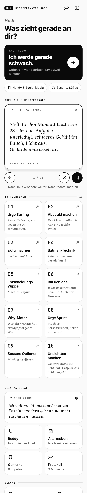
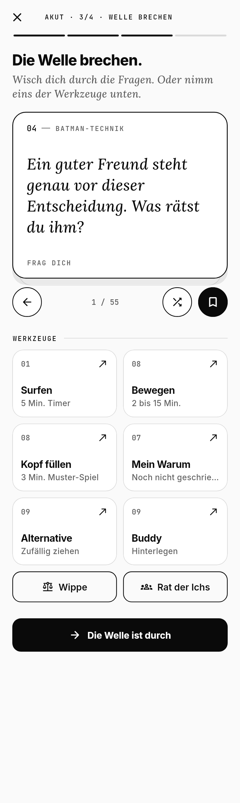

# Disziplinator 3000

Ein Werkzeugkasten für den Moment, in dem die Disziplin rutscht. Flutter-App, kein Login, keine Cloud: Alles bleibt auf deinem Handy.

Die Inhalte basieren auf [diesem YouTube-Video](https://www.youtube.com/watch?v=y7e3VLr1hgI) über zehn Techniken der Selbstkontrolle, ergänzt um Quellen und einen kritischen Blick auf jede Technik.

| Start | Akut-Modus | Technik (dunkel) |
|---|---|---|
|  |  |  |

## Was die App kann

**Akut-Modus** (die schwarze Kachel oben): in vier Schritten durch das Verlangen.
1. *Benennen.* Was lockt dich? Kategorie wählen, Stärke von 0 bis 10.
2. *Auslöser weg.* Konkrete Handgriffe passend zur Kategorie.
3. *Welle brechen.* Wisch-Stapel mit Fragen und Bildern plus Werkzeuge: Surfen, Bewegen, Kopf beschäftigen, Warum lesen, Alternative ziehen, Buddy anrufen, Wippe, Rat der Ichs.
4. *Bilanz.* Stärke danach, widerstanden oder nachgegeben. Hast du nachgegeben, bietet dir die App direkt den Auslöser-Check an.

**Kategorien**: Handy & Social Media, Essen & Süßes, Spontan kaufen, Serien & YouTube, Zocken, Rauchen & Alkohol, Pornos, Aufschieben, Etwas anderes. Eigene Kategorien legst du über „Eigenes hinzufügen“ im Akut-Modus, den Chip „Eigenes“ auf dem Startbildschirm oder in den Einstellungen an, jeweils mit eigenen Handgriffen, nüchternen Beschreibungen, Ekel-Bildern und Alternativen. Leere Felder füllt die App mit allgemeinen Vorschlägen auf. Langes Drücken auf eine eigene Kategorie im Akut-Modus öffnet sie zum Bearbeiten.

**Impuls-Stapel**: Karten mit Fragen zum Hinterfragen. Nach links wischen für die nächste, nach rechts zum Merken. Sätze aus deinem eigenen Warum-Brief tauchen im Stapel mit auf (schwarze Karten).

**Die 10 Techniken**, jede mit Erklärung, Forschung, „Kritisch hinterfragt“ und eigenem Werkzeug:

| Nr. | Technik | Werkzeug |
|---|---|---|
| 01 | Urge Surfing | Surf-Timer mit Welle und Körperfragen, wird jedes Mal eine Minute länger (bis 30 Min.) |
| 02 | Abstrakt machen | Nüchterne Beschreibungen je Kategorie, eigene Version merken |
| 03 | Eklig machen | Ekel-Bilder je Kategorie |
| 04 | Batman-Technik | Name und Vorbild für die dritte Person, Blick von außen |
| 05 | Entscheidungs-Wippe | 8 Felder mit Gewichten, die Wippe neigt sich live |
| 06 | Rat der Ichs | Jetzt-Ich, Abend-Ich, Zukunfts-Ich, 80-jähriges Ich und Hamster stimmen ab |
| 07 | Dein Warum | Brief an dich selbst mit Leitfragen, Lesemodus |
| 08 | Notfall-Sprint | Auslöser weg, Bewegungs-Timer, 3-Minuten-Merkspiel fürs Arbeitsgedächtnis |
| 09 | Bessere Optionen | Eigene Alternativen, Zufallsziehung, Buddy mit Anruf und SMS |
| 10 | Unsichtbar machen | Auslöser-Check: Wunsch, Gefühl, Gedanke, Situation, Umbau |

**Protokoll**: Erfolgsquote, Tage in Folge, häufigster Auslöser, kritischste Uhrzeit, was bei dir wirklich hilft.

## Design

Schwarz-Weiß, Hell- und Dunkelmodus (folgt dem System oder fest einstellbar). Drei Schriften mit klaren Rollen:

- **Inter** für Struktur: Titel, Knöpfe, Fließtext
- **Lora kursiv** für Fragen, Gedanken und Zitate
- **JetBrains Mono** für Nummern, Zeiten und Etiketten

Die Schriften liegen in `assets/fonts` (SIL Open Font License), die App funktioniert komplett offline.

## Auf das Handy bringen

### Android, ohne eigene Entwicklungsumgebung (empfohlen)
Bei jedem Push baut GitHub Actions die App und legt sie als Release ab.
1. Am Handy im Browser öffnen: `github.com/ausgepluescht/Disziplinator3000/releases/latest`
2. Unter *Assets* auf `Disziplinator.apk` tippen und herunterladen.
3. Die Datei öffnen. Android fragt einmal, ob der Browser Apps installieren darf: erlauben.
4. Installieren. Die App erscheint als „Disziplinator“ mit schwarzem D3K-Symbol.

Updates: neue APK genauso installieren, deine Daten bleiben erhalten. Play Protect warnt eventuell, weil die App nicht aus dem Play Store kommt: „Trotzdem installieren“.

### Android, lokal
```bash
flutter pub get
```
```bash
flutter build apk --release
```
Die APK liegt danach unter `build/app/outputs/flutter-apk/app-release.apk`. Oder mit angeschlossenem Handy direkt `flutter run --release`.

### iPhone
Braucht einen Mac mit Xcode: `ios/Runner.xcworkspace` öffnen, eigenes Team unter *Signing* wählen, auf das Gerät installieren. Mit einem kostenlosen Apple-Account läuft die App 7 Tage, dann neu installieren.

## Technik

- Flutter (Dart), Material 3, keine State-Management-Bibliothek
- Speicherung lokal über `shared_preferences`, ein JSON-Dokument
- `url_launcher` für Anruf und SMS an den Buddy
- Inhalte in `lib/data/techniques.dart` und `lib/data/cravings.dart`, leicht erweiterbar
- Tests: `flutter test`
